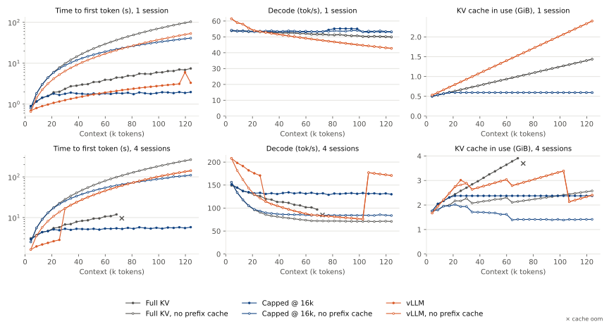
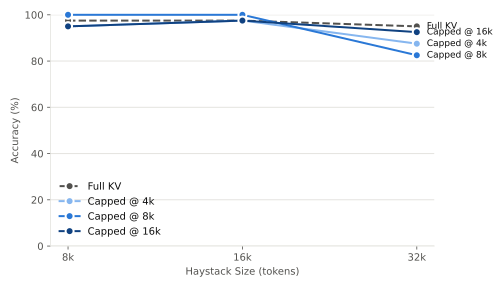

# Cosmonomic / PulsarLM

An LLM inference engine for persistent chat bots and agents.
It allows models to forget old and unimportant tokens
to keep context small and inference fast.
Best when paired with a memory system
for recalling forgotten context.

States are kept in an LRU cache in pinned host memory
(default 4 GiB and not persisted).

Only a handful of smaller and older models are
implemented right now,
but newer models are on the roadmap!


## How it works

PulsarLM is inspired by how short-term memory forgets.
During inference, custom attention kernels
accumulate the attention mass of each token page.
At regular intervals, pages that received little attention
are removed from the context,
while the system prompt and the most recent pages are always kept.
Forgotten information can be recovered
by pairing PulsarLM with an agent harness that recalls memories.
This keeps the context window bounded,
reducing the hardware needed for very long sessions.

Removing past tokens from the context breaks the prefix cache
that most engines rely on.
To work around this, PulsarLM stores snapshots of the context
at regular intervals in an external store,
and resumes a conversation from its latest snapshot.

To try it, `pip install pulsarlm` or see [Quickstart](#quickstart).

## Performance

### Small model throughput

On an RTX 5090, in bf16 with the default settings:

| Model       |     Prefill | Decode, 1 request | Decode, 16 requests |
| :---------- | ----------: | ----------------: | ------------------: |
| Gemma 4 E2B | 15.8k tok/s |         184 tok/s |          2.4k tok/s |
| Gemma 4 E4B | 11.2k tok/s |         113 tok/s |          1.4k tok/s |
| Gemma 4 12B |  4.8k tok/s |          56 tok/s |           681 tok/s |
| Qwen3 8B    |  6.7k tok/s |          89 tok/s |          1.2k tok/s |

Prefill is measured on a 5k-token prompt.
Decode is one request generating 512 tokens,
and 16 concurrent requests generating 256 tokens each.

### Growing conversations



Multi-turn chat sessions with Gemma 4 12B are evaluated on a single NVIDIA RTX 5090.
For each turn, a 4,096-token user message and a model reply of at most 256 tokens are appended,
and sessions grow to approximately 128k tokens of context.
Both engines are allotted a 4 GiB KV cache
and prefill at most 256 prompt tokens per step.
In the "Capped @ 16k" configuration, eviction limits the attention view to 16,384 tokens;
in the "no prefix cache" configurations, the entire conversation is recomputed at every turn.
The vLLM baseline is version 0.31.0.
Crosses denote turns that failed because the KV cache was exhausted (cache oom).

The last turn each run completed:

| Setting | Sessions | Context tokens | TTFT | Decode | KV cache | Run time | Ended |
| :--- | ---: | ---: | ---: | ---: | ---: | ---: | :--- |
| Full KV | 1 | 126,965 | 7.4 s | 50 tok/s | 1.44 GiB | 4 min | finished |
| Full KV, no prefix cache | 1 | 126,965 | 103 s | 50 tok/s | 1.44 GiB | 22 min | finished |
| Capped @ 16k | 1 | 126,965 | 2.0 s | 53 tok/s | 0.59 GiB | 3 min | finished |
| Capped @ 16k, no prefix cache | 1 | 126,965 | 41 s | 53 tok/s | 0.59 GiB | 12 min | finished |
| vLLM | 1 | 126,965 | 3.3 s | 43 tok/s | 2.40 GiB | 4 min | finished |
| vLLM, no prefix cache | 1 | 126,965 | 53 s | 43 tok/s | 2.40 GiB | 13 min | finished |
| Full KV | 4 | 70,051 | 12 s | 97 tok/s | 3.91 GiB | 5 min | cache oom at 74,147 tokens |
| Full KV, no prefix cache | 4 | 126,965 | 265 s | 71 tok/s | 2.58 GiB | 84 min | finished |
| Capped @ 16k | 4 | 126,965 | 5.8 s | 130 tok/s | 2.37 GiB | 7 min | finished |
| Capped @ 16k, no prefix cache | 4 | 126,965 | 110 s | 84 tok/s | 1.41 GiB | 47 min | finished |
| vLLM | 4 | 126,965 | 142 s | 171 tok/s | 2.40 GiB | 48 min | finished |
| vLLM, no prefix cache | 4 | 126,965 | 142 s | 171 tok/s | 2.40 GiB | 48 min | finished |

## Accuracy under eviction



Needle in a haystack, Gemma 4 12B.

## Quickstart

```sh
pip install pulsarlm

# list and download implemented models
pulsarlm models
pulsarlm download gemma-4-e2b-it

# start a chat
pulsarlm chat gemma-4-e2b-it

# or start an OpenAI compatible API server
pulsarlm serve gemma-4-e2b-it
```

## Requirements

- Linux, x86_64 or aarch64, glibc >= 2.34 (Ubuntu 22.04+, Debian 12+, RHEL 9+)
- NVIDIA GPU with compute capability >= 8.0 (Ampere or newer)
- NVIDIA driver >= 580 (CUDA 13)
- Python 3.13 or 3.14

If installing from sdist or building from source:

- nvcc >= 13.2
- gcc >= 15
- xmake
- OpenSSL 3 headers

## Development

Requires `uv` and the source build requirements above.
To get started:

```sh
uv sync
```

## Disclaimer

This project has only been tested on x86_64 with an RTX 5090.
Wheels for other GPUs and for aarch64 are built but untested.

